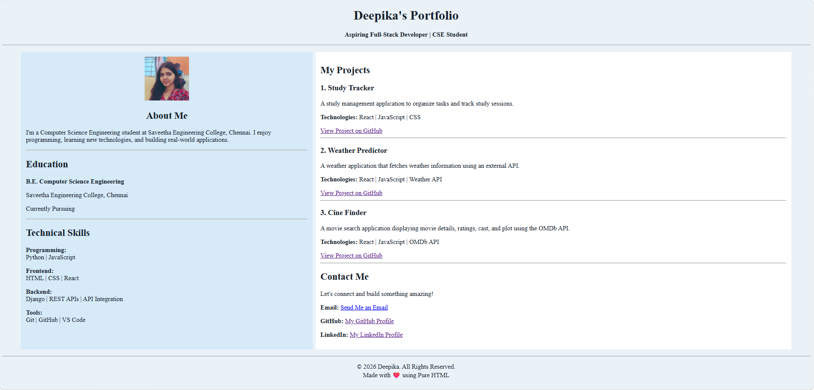

# Ex01 Portfolio
## Date: 24/10/2026

## AIM
To create a Portfolio using HTML and CSS.

## ALGORITHM
### STEP 1
Create an HTML file (index.html)

### STEP 2
Create a CSS file (style.css)

### STEP 3
Include a navigation bar with links to different sections.

### STEP 4
Add structured sections for introduction, about, projects, and contact details.

### STEP 5
Define global styles for fonts, colors, and layout.

### STEP 6
Style the header, navigation bar, and sections.

### STEP 7
Use Flexbox or CSS Grid for layout design.

### STEP 8
Add hover effects and transitions for interactivity.

### STEP 9
Add Images and Media.

### STEP 10
Use optimized images for a professional look.

### STEP 11
Open the HTML file in a browser to check layout and functionality.

### STEP 12
Fix styling issues and refine content placement.

### STEP 13
Deploy the Portfolio.

### STEP 14
Upload to GitHub Pages for free hosting.

## PROGRAM
```

<!DOCTYPE html>
<html lang="en">

<head>
    <meta charset="UTF-8">
    <meta name="viewport" content="width=device-width, initial-scale=1.0">
    <title>Deepika | Portfolio</title>
</head>

<body bgcolor="#EAF2F8" text="#17202A">

<center>

    <h1>Deepika's Portfolio</h1>
    <p><b>Aspiring Full-Stack Developer | CSE Student</b></p>

    <hr>

    <table width="96%" cellpadding="12" cellspacing="8">
        <tr>

            <!-- LEFT SIDE -->
            <td width="38%" valign="top" bgcolor="#D6EAF8">

                <center>
                    

                    <h2>About Me</h2>
                </center>

                <p>
                    I'm a Computer Science Engineering student at
                    Saveetha Engineering College, Chennai.
                    I enjoy programming, learning new technologies,
                    and building real-world applications.
                </p>

                <hr>

                <h2>Education</h2>

                <p><b>B.E. Computer Science Engineering</b></p>
                <p>Saveetha Engineering College, Chennai</p>
                <p>Currently Pursuing</p>

                <hr>

                <h2>Technical Skills</h2>

                <p><b>Programming:</b><br>
                    Python | JavaScript
                </p>

                <p><b>Frontend:</b><br>
                    HTML | CSS | React
                </p>

                <p><b>Backend:</b><br>
                    Django | REST APIs | API Integration
                </p>

                <p><b>Tools:</b><br>
                    Git | GitHub | VS Code
                </p>

            </td>

            <!-- RIGHT SIDE -->
            <td width="62%" valign="top" bgcolor="#FFFFFF">

                <h2>My Projects</h2>

                <h3>1. Study Tracker</h3>

                <p>
                    A study management application to organize tasks
                    and track study sessions.
                </p>

                <p><b>Technologies:</b> React | JavaScript | CSS</p>

                <a href="https://github.com/deepika-annamalai/study-tracker-react"
                   target="_blank"
                   rel="noopener noreferrer">
                    View Project on GitHub
                </a>

                <hr>

                <h3>2. Weather Predictor</h3>

                <p>
                    A weather application that fetches weather
                    information using an external API.
                </p>

                <p><b>Technologies:</b> React | JavaScript | Weather API</p>

                <a href="https://github.com/deepika-annamalai/weather-predictor-react"
                   target="_blank"
                   rel="noopener noreferrer">
                    View Project on GitHub
                </a>

                <hr>

                <h3>3. Cine Finder</h3>

                <p>
                    A movie search application displaying movie details,
                    ratings, cast, and plot using the OMDb API.
                </p>

                <p><b>Technologies:</b> React | JavaScript | OMDb API</p>

                <a href="https://github.com/deepika-annamalai/cine-finder-react"
                   target="_blank"
                   rel="noopener noreferrer">
                    View Project on GitHub
                </a>

                <hr>

                <h2>Contact Me</h2>

                <p>Let's connect and build something amazing!</p>

                <p>
                    <b>Email:</b>
                    <a href="mailto:deepikasakthiannamalai@gmail.com">
                        Send Me an Email
                    </a>
                </p>

                <p>
                    <b>GitHub:</b>
                    <a href="https://github.com/deepika-annamalai"
                       target="_blank"
                       rel="noopener noreferrer">
                        My GitHub Profile
                    </a>
                </p>

                <p>
                    <b>LinkedIn:</b>
                    <a href="https://www.linkedin.com/in/deepika-sakthi-annamalai"
                       target="_blank"
                       rel="noopener noreferrer">
                        My LinkedIn Profile
                    </a>
                </p>

            </td>

        </tr>
    </table>

    <hr>

    <p>
        &copy; 2026 Deepika. All Rights Reserved.
        <br>
        Made with ❤️ using Pure HTML
    </p>

</center>

</body>
</html>

```

## OUTPUT


## RESULT
The program for creating Portfolio using HTML and CSS is executed successfully.
